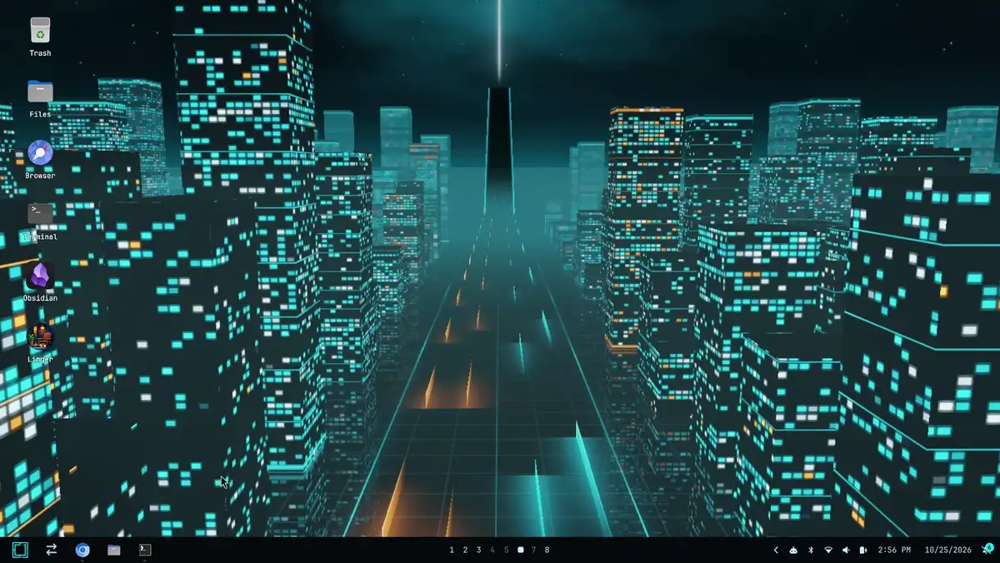
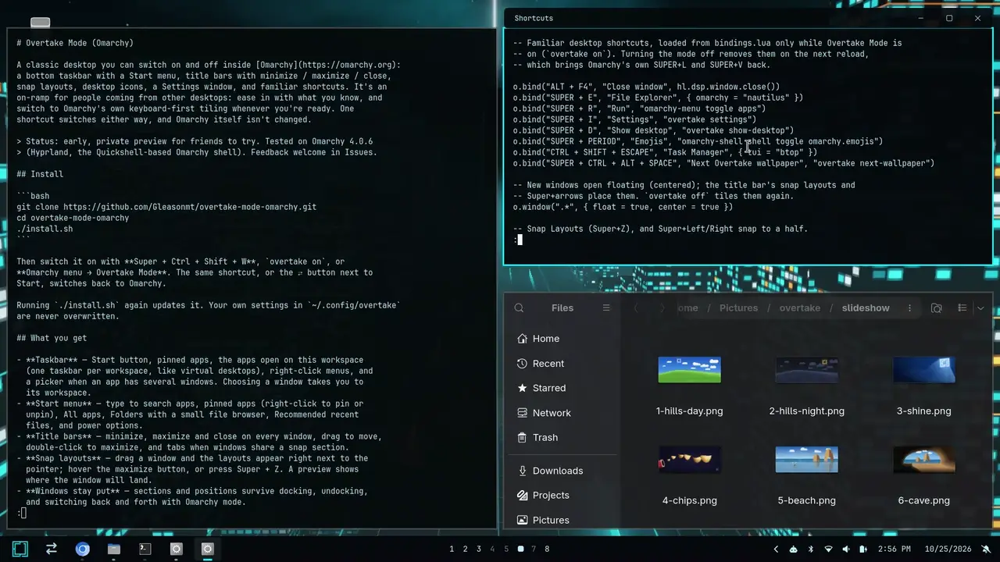
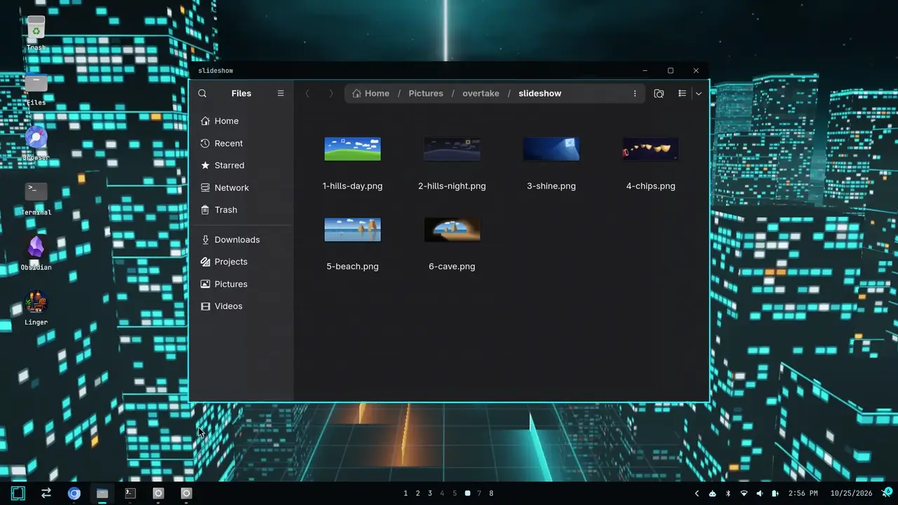
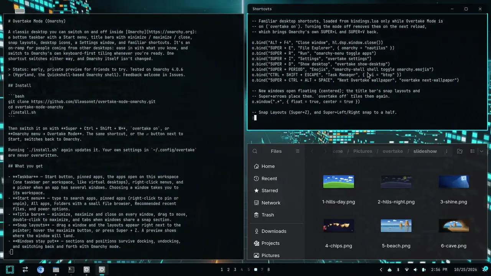
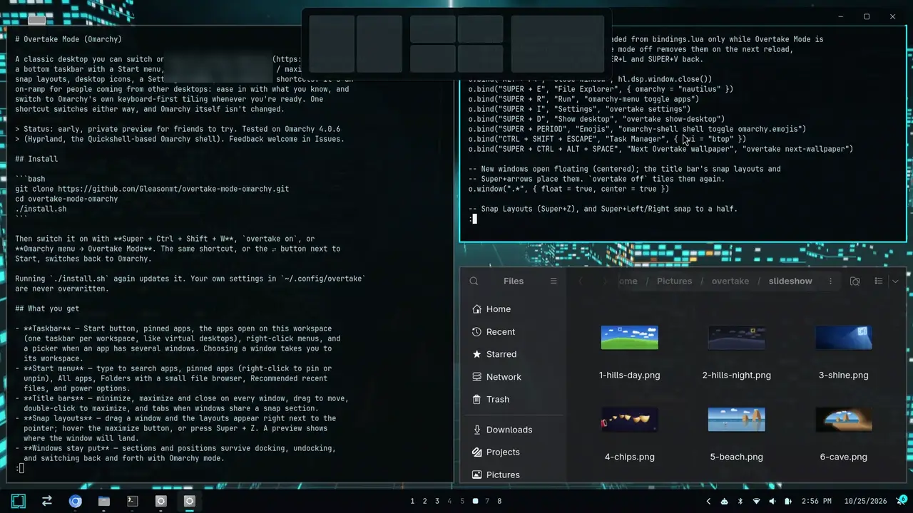
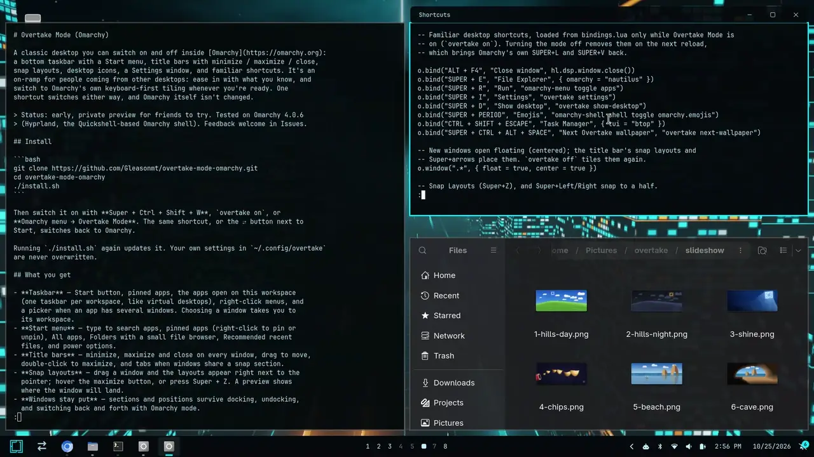

# Overtake Mode (Omarchy)

A classic desktop you can switch on and off inside [Omarchy](https://omarchy.org):
a bottom taskbar with a Start menu, title bars with minimize / maximize / close,
snap layouts, desktop icons, a Settings window, and familiar shortcuts. It's an
on-ramp for people coming from other desktops: ease in with what you know, and
switch to Omarchy's own keyboard-first tiling whenever you're ready. One
shortcut switches either way, and Omarchy itself isn't changed.

It comes in two looks, switchable any time (`overtake style classic|studio`,
Settings → Overtake Mode, or the Omarchy menu):

- **Classic** — taskbar and Start menu along the bottom.
- **Studio** — a menu bar along the top, a Dock at the bottom, Spotlight
  search, and the Super key working as a Command key. See [Studio](#studio).



> Status: early. Tested on Omarchy 4.0.6 (Hyprland, the Quickshell-based
> Omarchy shell). Feedback and pull requests welcome in Issues.

## Install

```bash
git clone https://github.com/Gleasonmt/overtake-mode-omarchy.git
cd overtake-mode-omarchy
./install.sh
```

Then switch it on with **Super + Ctrl + Shift + W**, `overtake on`, or
**Omarchy menu → Overtake Mode**. The same shortcut, or the ⇄ button next to
Start, switches back to Omarchy.

Running `./install.sh` again updates it. Your own settings in `~/.config/overtake`
are never overwritten.

## See it in action

**One shortcut between Omarchy and Overtake Mode.** Your windows come back
exactly where they were.



**Snap windows** to halves, quarters or full screen, and back.



**Snap layouts:** hover the maximize button, or press Super + Z.



**Settings** for display, power and battery alerts for every device, screensaver,
themes and more (Super + I).



**Notification center:** notifications slide off the screen into the bell,
grouped by app, with per-app Show / Quiet / Off and Do Not Disturb.



## What you get

- **Taskbar** — Start button, pinned apps, the apps open on this workspace
  (one taskbar per workspace, like virtual desktops), right-click menus, and
  a picker when an app has several windows. Choosing a window takes you to
  its workspace.
- **Start menu** — type to search apps, pinned apps (right-click to pin or
  unpin), All apps, Folders with a small file browser, Recommended recent
  files, and power options.
- **Title bars** — minimize, maximize and close on every window, drag to move,
  double-click to maximize, and tabs when windows share a snap section.
- **Snap layouts** — drag a window and the layouts appear right next to the
  pointer; hover the maximize button, or press Super + Z. A preview shows
  where the window will land.
- **Move to a workspace by dragging** — while you drag a window, workspaces
  1–9 show as boxes along the top of the screen (a dot marks ones with
  windows). Drop it on one to send it there; you stay where you are.
- **New windows fill the gaps** — open an app or click a link next to a
  snapped window and it lands in the half or quarter left free (Settings >
  Overtake Mode turns this off). Links open on the workspace you're on,
  in the browser window there or a new one.
- **Windows stay put** — sections and positions survive docking, undocking,
  and switching back and forth with Omarchy mode.
- **Settings** — Super + I opens a Settings window for display, sound,
  Bluetooth, Wi-Fi, power, themes, fonts, default apps, time and updates.
- **Notification center** — toasts slide off after 10 seconds (critical ones
  after 15) into the bell at the end of the taskbar, which counts new ones.
  Its panel groups them by app, newest first; open an app to see its
  notifications, click one to act on it (runs its action or brings the app
  forward), or clear one, an app's, or all. The gear opens **Manage**, where
  each app is set to Show, Quiet (no pop-ups, still collected) or Off
  (saved in `~/.config/overtake/notifications.json`). Do Not Disturb sits at the
  bottom. Toasts on screen have an × too.
- **Touchpad right-click in the corner** — the bottom-right of the touchpad
  right-clicks, as on most laptops (Omarchy uses a two-finger click).
- **Battery alerts for every device** — the laptop and anything connected that
  reports a battery (Bluetooth or USB mice, keyboards, headsets, controllers)
  each get a Low and a Critical alert at levels you choose, in Settings →
  Power & battery (kept in `~/.config/overtake/battery-alerts.json`). Critical
  ones get through Do Not Disturb. They replace Omarchy's single 10% laptop
  warning while the mode is on; its `battery-low` hook still runs.
- **Click the desktop to see it** — a click on empty desktop minimizes the
  windows on that workspace.
- **Screensaver & lock settings** — Settings → Screensaver & lock (or right-click
  the desktop): on/off, when it starts and when the screen locks, and what it shows:
  Omarchy's logo, your wallpaper turned into screensaver art, an image, or your own text.
- **Image folders** — opening an image opens its whole folder in the image viewer,
  so the left and right arrow keys step through the others.
- **Themes in folders** — Omarchy menu → Style → Theme opens Omarchy themes, Your
  themes (the ones you added) or All themes, in plain Omarchy too; Settings →
  Personalization shows your themes first, each section foldable.
- **Desktop with right-click menus** — right-click an icon to open, pin to
  Start, rename, move or remove it (and empty the Trash); right-click the
  desktop for icon size, sort, show/hide icons, add a shortcut (Start → right-
  click an app → Add to desktop), background, theme, Personalize and Display
  settings.
- **Desktop icons**, a **wallpaper slideshow** (rotate every 15 minutes, or
  follow sunrise and sunset), and an **Overtake Mode** entry in the Omarchy menu.

## Studio

The second look, for people used to a menu bar and a Dock. Everything else
above (title bars, snapping, notifications, Settings, battery alerts,
wallpapers, dock/undock layouts) works the same in both looks.

- **Menu bar** — the Omarchy logo opens the system menu (About, System
  Settings, Force Quit, Sleep / Restart / Shut Down, Lock, Log Out, and the
  look switch). Next to it, the focused app's name in bold, then File, Edit,
  View, Window and Help. Linux apps don't hand their own menus to the
  desktop, so these hold what works in every app: new window and tab, the
  edit keys (sent to the app), full screen, zoom, tiling, and the app's
  windows. Workspace numbers sit in the middle (click one to go there);
  status icons, Spotlight and Control Center on the right; the
  clock opens the notification center.
- **Dock** — pinned and running apps (a dot means running), minimized windows
  after the divider, then Downloads (click for the newest files) and Trash.
  Click to open or switch to an app (clicking the focused app minimizes it),
  middle-click for a new window, right-click for its windows, Keep in Dock,
  Hide and Quit; drag pinned apps to reorder. Size, magnification and
  auto-hide are in Settings → Overtake Mode.
- **Title bars** — close / minimize / zoom as coloured dots on the left, the
  title in the middle. Hold the pointer on the green dot (or Super + Z) for
  the tile menu: halves, quarters, Fill, Center, full screen.
- **Tiling by dragging** — drag a window to the left or right edge of the
  screen for a half, a corner for a quarter, the menu bar to fill the screen.
  The workspace boxes still appear along the top while you drag.
- **Spotlight** (Super + Space) — apps, actions (lock, sleep, theme, Wi-Fi,
  screenshot…), files in your home folder, and quick sums (`12*4`; Enter
  copies the answer). Tab switches to **Apps**, every app in a grid (also the
  first icon in the Dock); right-click an app there to keep it in the Dock.
- **App Switcher** (hold Super, tap Tab) — apps by most recent use; let go to
  switch, Q quits the picked app, Esc cancels. Super + \` steps through the
  focused app's windows.
- **Mission Control** (Ctrl + ↑) — live previews of this workspace's windows
  and the workspaces above them; click to go, drag a window onto a workspace
  to move it.
- **Control Center** — Wi-Fi, Bluetooth, Focus (do not disturb), Night Light,
  Stay Awake, screen recording and screenshots, display and sound sliders,
  and what's playing.
- **Force Quit** (Super + Alt + Esc) — end an app that has stopped responding.
- Desktop icons sit on the right, and Studio has its own wallpapers (Day &
  Night uses the mesa pair).

### Studio shortcuts (Super works as Command)

| Keys | Does |
| --- | --- |
| Super + Space | Spotlight |
| Super + Tab | App Switcher |
| Super + Q / H / M | Quit the app / hide it / minimize the window |
| Super + Alt + H | Hide the other apps |
| Super + W | Close the tab (browsers) or the window |
| Super + C / V / X | Copy / paste / cut (Omarchy's universal keys) |
| Super + A / Z / Shift + Z / S / F / T / N / O / P / R / L | Reach the app as Ctrl + the same key (select all, undo, redo, save, find, new tab…); terminals get Ctrl + Shift where it makes sense |
| Super + ← / → / ↑ / ↓ | Start / end of the line, top / bottom of the document |
| Alt + ← / → / Backspace | Word left / right / delete a word |
| Super + [ / ] | Back / forward |
| Super + = / − | Zoom in / out |
| Ctrl + Super + ← / → / ↑ / ↓ / C | Tile left / right, fill, previous size, center |
| Ctrl + Super + F | Full screen |
| Ctrl + ↑ | Mission Control |
| Ctrl + ← / → | Previous / next workspace (Super + 1–9 still go straight to one) |
| Super + Shift + 3 / 4 / 5 | Screenshot of the screen / a region / the capture menu |
| Super + , | Settings |
| Super + Alt + Esc | Force Quit |
| Ctrl + Super + Q | Lock |
| Ctrl + Super + Space | Emoji |
| Super + Alt + Space | Omarchy menu |
| Super + F3 | Show desktop |

Like Classic's, these replace Omarchy shortcuts only while the mode is on.
Super + Shift + 3 / 4 / 5 take over moving a window to workspace 3–5
(dragging it onto a workspace box still does that).

## Shortcuts (Classic, while Overtake Mode is on)

| Keys | Does |
| --- | --- |
| Super (tap) | Start |
| Super + S | Start, ready to search |
| Super + X | Quick links menu |
| Super + E / I / R | Files / Settings / Run |
| Super + D | Show desktop |
| Super + Z | Snap layouts |
| Super + ← / → | Snap left / right |
| Super + ↑ / ↓ | Maximize / minimize |
| Super + L | Lock |
| Super + V | Clipboard history |
| Ctrl + Shift + Esc | Task manager |
| Alt + F4 | Close window |
| Super + Ctrl + Shift + W | Switch between Overtake and Omarchy |

These replace a few Omarchy shortcuts only while the mode is on (for example
Super + S is normally the scratchpad); switching back restores them all.

## Customising

All in `~/.config/overtake/`:

- `style` — `classic` or `studio` (`overtake style` sets it)
- `start-pinned.txt` — Start menu pins (or right-click apps in Start)
- `dock-pinned.txt` — Studio's Dock pins (or right-click apps in the Dock)
- `studio.json` — Studio's Dock size, magnification and auto-hide (Settings sets them)
- `desktop-icons.txt` — desktop icons (`trash`, `browser`, `terminal`, or any app)
- `no-controls.txt` — apps that keep their own window buttons instead of
  Overtake's title bar

`overtake` on its own lists every command (snap, minimize, wallpaper modes…).

## What it installs

| Where | What |
| --- | --- |
| `~/.local/bin/overtake` | the command |
| `~/.config/hypr/overtake.lua`, `overtake-classic.lua`, `overtake-studio.lua` | the window rules and each look's shortcuts, loaded only while the mode is on |
| `~/.config/hypr/bindings.lua`, `autostart.lua` | a few lines between `>>> overtake` / `<<< overtake` markers |
| `~/.config/omarchy/plugins/overtake.taskbar` | taskbar, Start menu, title bars, desktop icons, Settings; Studio's Dock, Spotlight, App Switcher, Mission Control and Force Quit |
| `~/.config/omarchy/plugins/overtake.menubar`, `overtake.control-center` | Studio's menu bar, and its Spotlight and Control Center buttons |
| `~/.config/omarchy/plugins/overtake.{workspaces,bluetooth,audio}` | copies of Omarchy's own widgets, made from your installed Omarchy, with small changes (no gaps in the workspace list; right-click opens the Bluetooth and sound panels instead of turning Bluetooth off or muting) |
| `~/.config/omarchy/plugins/overtake.notifications` | a copy of Omarchy's notifications with a close button on each card, critical toasts leaving after 15 s instead of never, and a 50-entry history for the notification center. Loaded in both modes: with Overtake Mode off it behaves exactly like Omarchy's own, so switching needs no shell restart |
| `~/.config/omarchy/plugins/overtake.battery` | a copy of Omarchy's battery service; while the mode is on its fixed 10% warning gives way to Overtake's battery alerts, otherwise it's Omarchy's own |
| `~/.config/omarchy/plugins/overtake.notification-center` | the bell and its panel; it reads Omarchy's notification history folder (`~/.local/state/omarchy/notifications/history`). `omarchy-shell overtake.notification-center toggle` opens it |
| `~/.config/omarchy/extensions/omarchy-menu.jsonc` | the Overtake Mode menu entry, between markers |
| `~/.config/overtake/`, `~/Pictures/overtake/` | your settings and the wallpapers |

If a future Omarchy changes one of those widgets so the change no longer
applies, the installer says so and Overtake uses Omarchy's own one.

## Privacy

Overtake Mode sends nothing anywhere, with one exception: the **Day & Night**
wallpaper mode looks up today's sunrise and sunset from
[wttr.in](https://wttr.in), which estimates your location from your IP address.
The default **Rotate** mode makes no network requests.

## Uninstall

```bash
./uninstall.sh          # keeps ~/.config/overtake and the wallpapers
./uninstall.sh --purge  # removes those too
```

## Known limits

- Apps that draw their own title bar and can't hide it (Discord's desktop app,
  for one) keep their own buttons; listed in `no-controls.txt`.
- Dragging such an app by its own title area snaps when you hold still over a
  layout for half a second, since Hyprland doesn't report their mouse button.
- Studio's menus are the same for every app (apps on Linux don't share
  their own menus with the desktop); app-specific commands stay in the app.
- Studio's Super-as-Command keys are sent to the app as Ctrl + key, so an app
  that uses a different key for something (say, find) won't respond to the
  usual one.
- Network picking, Bluetooth pairing and detailed sound settings open
  Omarchy's own panels; screen resolution and keyboard layouts open the
  config file.

## Wallpapers

Original art made for this project; see `wallpapers/src` for the scripts that
draw some of them.

## License

[MIT](LICENSE)
