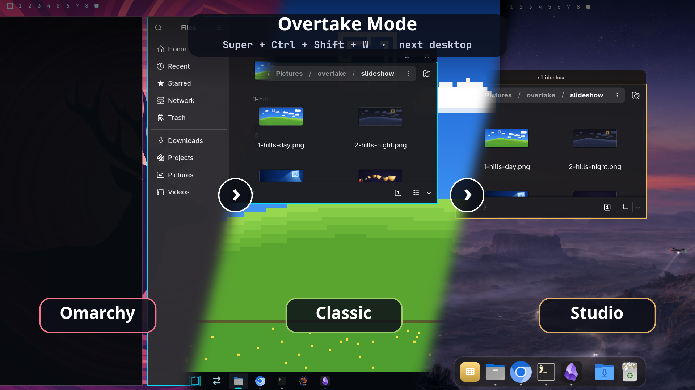
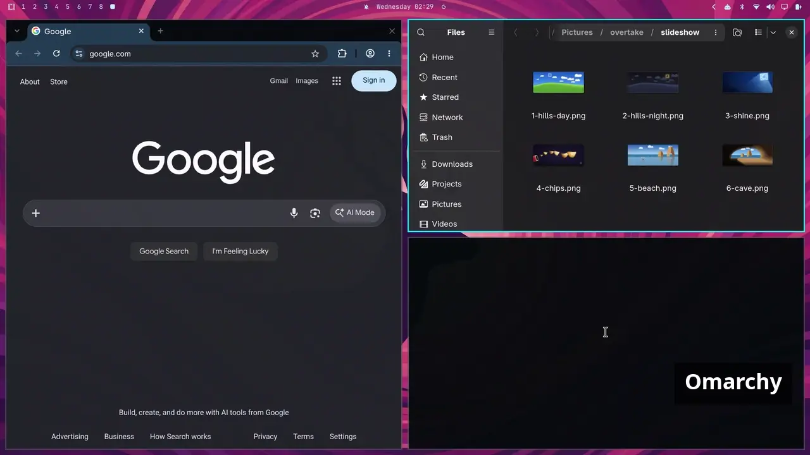
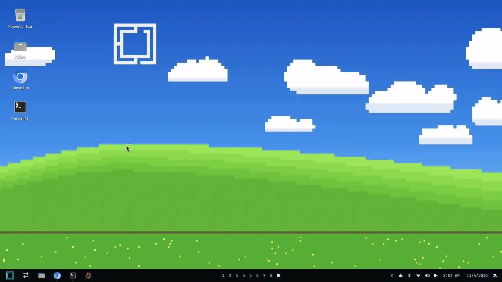
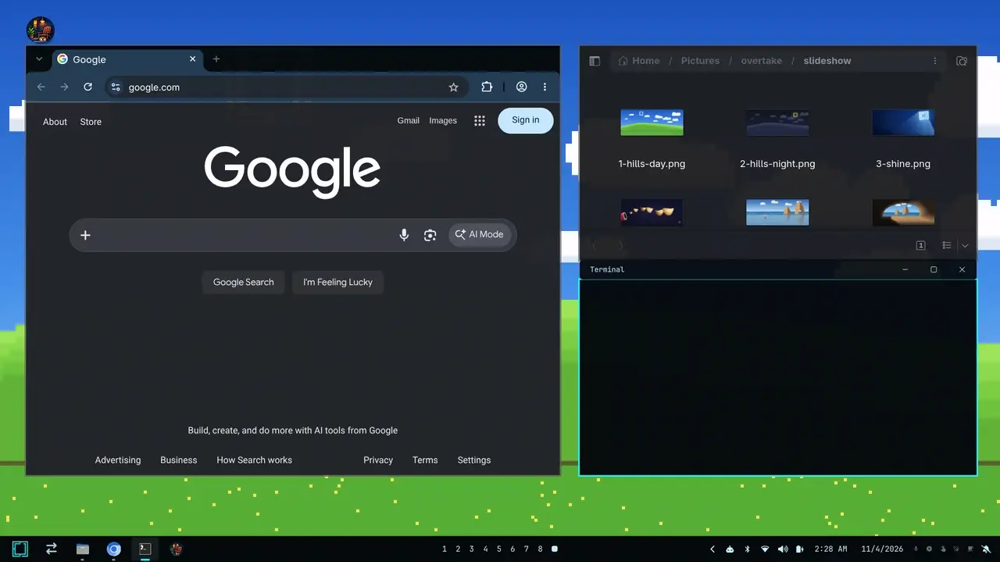
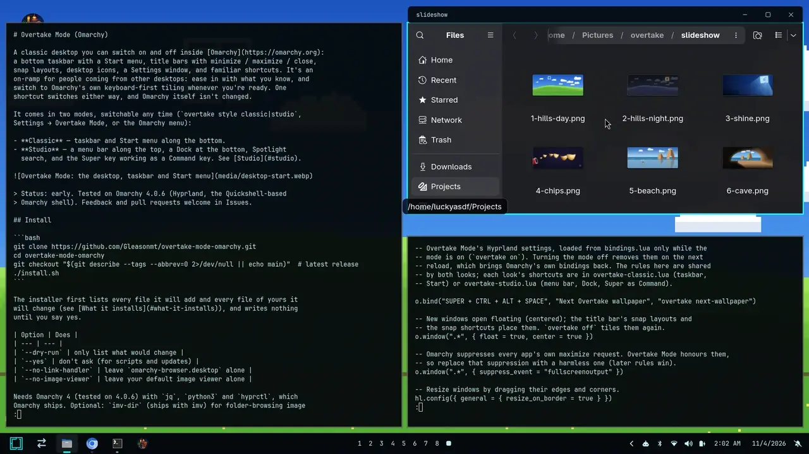
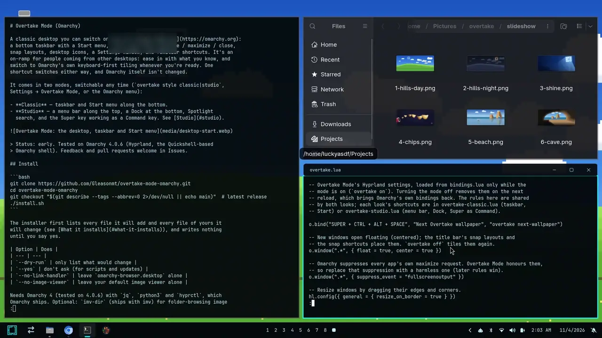
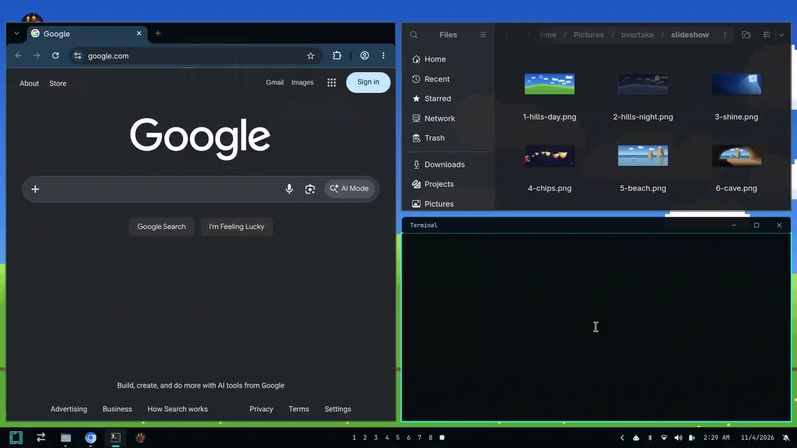

# Overtake Mode (Omarchy)



A classic desktop you can switch on and off inside [Omarchy](https://omarchy.org):
a bottom taskbar with a Start menu, title bars with minimize / maximize / close,
snap layouts, desktop icons, a Settings window, and familiar shortcuts. It's an
on-ramp for people coming from other desktops: ease in with what you know, and
switch to Omarchy's own keyboard-first tiling whenever you're ready. One
shortcut switches either way. Omarchy's installed files aren't modified; the changes Overtake makes to your settings are listed under [What it installs](#what-it-installs), and uninstalling reverses them.

It comes in two modes, switchable any time (`overtake style classic|studio`,
Settings → Overtake Mode, or the Omarchy menu):

- **Classic** — taskbar and Start menu along the bottom.
- **Studio** — a menu bar along the top, a Dock at the bottom, Spotlight
  search, and the Super key working as a Command key. See [Studio](#studio).



### How this differs from Omarchy's floating workspaces

Omarchy 4.5 can float one workspace at a time, with its own title bars and a
Dock (Super + L). Overtake Mode is a different thing: **one shortcut changes the
whole desktop**, each mode with its own look, and takes you straight back to
Omarchy as it ships.

| | Omarchy's floating workspaces | Overtake Mode |
| --- | --- | --- |
| Changes | how one workspace arranges its windows | the whole desktop: bar, shortcuts, title bars, panels, notifications, theme and wallpaper |
| Look | Omarchy's bar, title bars with × □ − on the right | Classic's taskbar and Start menu, or Studio's menu bar and coloured dots |
| Also has | | snap layouts and tabs, a Settings window, Spotlight, a notification center, per-device battery alerts |

The two don't run together: while a mode is on, Overtake pauses floating
workspaces and its shortcuts for them, and puts them back when you switch to Omarchy.

> Status: early. Tested on Omarchy 4.5.0 (Hyprland, the Quickshell-based
> Omarchy shell). Feedback and pull requests welcome in Issues.

## Install

```bash
git clone --branch v0.1.16 https://github.com/Gleasonmt/overtake-mode-omarchy.git && cd overtake-mode-omarchy && ./install.sh
```

The installer lists every file it will add and every file of yours it will
change (see [What it installs](#what-it-installs)), and writes nothing until
you say yes. `--dry-run` only lists; `--yes` doesn't ask.

In Omarchy mode, Omarchy runs as it ships: Overtake's bar, notifications,
battery alerts and shortcuts apply in Classic and Studio, and switching to
Omarchy puts everything back. What stays in every mode: the mode shortcut, a
login check that the patched copies still match your Omarchy, the Omarchy menu
entry, the post-update hook and a Recycle Bin entry in the app launcher. (Changes you
make yourself in Overtake's Settings, like the screensaver art, are yours and
stay.)

Needs Omarchy 4.5 or later (tested on 4.5.0). Everything it uses ships with Omarchy,
including `jq`, `python3` (with its GObject bindings), `hyprctl`, `fd`, `curl`,
`flock`, ImageMagick (`magick`), libvips (`vipsthumbnail`), `gtk-launch` and `wl-copy`. Optional: Nautilus for the Recycle Bin app. (`tests/run.sh` needs `node`, `jq` and `python3`; `qs`, `fd`, `dbus-run-session`, `notify-send`, `vipsthumbnail` and `unshare -r -m -n` for the real parts, which are skipped without them, and without `luac` the Lua blocks get a simpler check; `t-full-disk.sh` needs `unshare -r -m`.)

Then switch it on with **Super + Ctrl + Shift + W**, `overtake on`, or
**Omarchy menu → Overtake Mode**. Each press of the shortcut goes to the next
mode: Omarchy → Classic → Studio → back to Omarchy. The ⇄ button next to
Start also switches back to Omarchy.

To update, check out the newest release (`git fetch --tags && git tag --sort=-v:refname | head -1`
names it) and run the installer again (your own settings in `~/.config/overtake` are never overwritten):

```bash
git checkout <that tag> && ./install.sh
```

Added it with `omarchy plugin add` (or from the plugin marketplace)? That only
copies this repository's default branch into `~/.config/omarchy/plugins/gleasonmt.overtake-mode`,
whose small root plugin (`Setup.qml`), once enabled, reminds you to finish with
`./install.sh` in that folder. Overtake Mode is several plugins plus a command and Hyprland settings, so the installer is
what sets it up; after `omarchy plugin update`, run `./install.sh` there again (the same reminder asks you to, until the installed version catches up).

## See it in action

**Classic:** a taskbar, desktop icons and a Start menu with your pinned apps,
folders and recent files.



**Snap windows** to halves, quarters or full screen, and back.



**Snap layouts:** hover the maximize button, or in Classic press Super + Z.



**Settings** for display, power and battery alerts for every device, screensaver,
themes and more (Super + I).



**Notification center:** notifications slide off the screen into the bell,
grouped by app, with per-app Show / Quiet / Off and Do Not Disturb.



## What you get

- **Taskbar** — Start button, pinned apps, the apps open on this workspace
  (one taskbar per workspace, like virtual desktops), right-click menus, and
  a picker when an app has several windows. Choosing a window takes you to
  its workspace.
- **Start menu** — type to search apps, pinned apps (right-click to pin or
  unpin), All apps, Folders with a small file browser, Recommended recent
  files, and power options.
- **Title bars** — minimize, maximize and close on every window, drag to move,
  double-click to maximize, and tabs when windows share a snap section.
- **Snap layouts** — drag a window and the layouts appear right next to the
  pointer; hover the maximize button, or in Classic press Super + Z. A preview shows
  where the window will land.
- **Move to a workspace by dragging** — while you drag a window, workspaces
  1–9 show as boxes along the top of the screen (a dot marks ones with
  windows). Drop it on one to send it there; you stay where you are.
- **New windows fill the gaps** — open an app or click a link next to a
  snapped window and it lands in the half or quarter left free (Settings >
  Overtake Mode turns this off).
- **Windows stay put** — sections and positions survive docking, undocking,
  and switching back and forth with Omarchy mode.
- **Settings** — Super + I in Classic (Super + comma in Studio) opens a Settings window for display, sound,
  Bluetooth, Wi-Fi, power, themes, fonts, default apps, time and updates.
- **Notification center** — toasts slide off after 10 seconds (low-urgency ones
  after 5, critical ones after 15) into the bell at the end of the taskbar, which counts new ones.
  Its panel groups them by app, newest first; open an app to see its
  notifications, click one to act on it (runs its action, opens the site for a browser's notification,
  or brings the app forward), or clear one, an app's, or all. It holds what Omarchy keeps: the
  last 100, for a day from when each closed. The gear opens **Manage**, where each app is set to
  Show, Quiet (still collected, with no pop-ups except verification codes, critical battery alerts, Omarchy's own messages and critical alerts from scripts; temporary notifications still pop up, as they can't be collected) or Off (saved in
  `~/.config/overtake/notifications.json`). Do Not Disturb sits at the bottom. It hides most pop-ups; verification codes, critical battery alerts, Omarchy's own messages and critical alerts from scripts still show, and plain `notify-send` messages and temporary notifications aren't kept.
- **Touchpad right-click in the corner** — the bottom-right of the touchpad
  right-clicks, as on most laptops (Omarchy uses a two-finger click).
- **Battery alerts for every device** — the laptop and anything connected that
  reports a battery (Bluetooth or USB mice, keyboards, headsets, controllers)
  each get a Low and a Critical alert at levels you choose, in Settings →
  Power & battery (kept in `~/.config/overtake/battery-alerts.json`). Critical
  ones get through Do Not Disturb. They replace Omarchy's single 10% laptop
  warning while the mode is on; its `battery-low` hook still runs, at the laptop's Critical level, while laptop alerts are on.
- **Click the desktop to see it** — a click on empty desktop minimizes the
  windows on that workspace.
- **Screensaver & lock settings** — Settings → Screensaver & lock (or right-click
  the desktop): on/off, when it starts and when the screen locks, and what it shows:
  Omarchy's logo, your wallpaper turned into screensaver art, an image, or your own text.
- **Themes in folders** — Settings → Personalization shows your themes first,
  each section foldable.
- **Desktop with right-click menus** — right-click an icon to open, pin to
  Start, rename, move or remove it (and empty the Recycle Bin); right-click the
  desktop for icon size, sort, show/hide icons, add a shortcut (Start → right-
  click an app → Add to desktop), background, theme, Personalize and Display
  settings.
- **Desktop icons**, a **wallpaper slideshow** (rotate every 15 minutes, or
  follow sunrise and sunset), and an **Overtake Mode** entry in the Omarchy menu.
  A wallpaper you pick yourself stays put; Super+Ctrl+Alt+Space goes back to
  the slideshow.
- **Every wallpaper in Change background** (the desktop's right-click menu),
  named by where it comes from: this theme's own ("Topside Mountain
  View (This Theme, Live)"), the live wallpapers of your other themes
  ("Topside Dusk (Live)"), the Classic and Studio pictures, then every other
  theme's backgrounds, Omarchy's own included ("Tokyo Night 2"). So a
  different live wallpaper doesn't mean a different theme: the theme sets
  the colours, Background sets the wallpaper.
- **A theme and wallpaper per mode** — Omarchy (Overtake Mode off), Classic and Studio each
  remember their own theme and wallpaper. Pick a theme while in Studio and
  Studio keeps it; switching modes puts each one's back.

## Studio

The second mode, for people used to a menu bar and a Dock. Everything else
above (title bars, snapping, notifications, Settings, battery alerts,
wallpapers, dock/undock layouts) is in both modes; Studio's keys differ, as Super
works as Command there (Super + Z is Undo, Super + I is Italic).

- **Menu bar** — the Omarchy logo opens the system menu (About, System
  Settings, Force Quit, Sleep / Restart / Shut Down, Lock, Log Out, and the
  mode switch). Next to it, the focused app's name in bold, then File, Edit,
  View, Window and Help. Linux apps don't hand their own menus to the
  desktop, so these hold what works in every app: new window and tab, the
  edit keys (sent to the app), full screen, zoom, tiling, and the app's
  windows. Workspace numbers sit in the middle (click one to go there);
  status icons, Spotlight and Control Center on the right; the
  clock opens the notification center.
- **Dock** — pinned and running apps (a dot means running), then Downloads
  (click for the newest files) and the Recycle Bin. Click to open or switch to an app
  (clicking the focused app minimizes it, clicking it again brings it back; an
  app with several windows lists them, with their workspaces), middle-click
  for a new window, right-click for its windows, Keep in Dock,
  Hide and Quit; drag pinned apps to reorder. Size, magnification and
  auto-hide are in Settings → Overtake Mode.
- **Title bars** — close / minimize / zoom as coloured dots on the left, the
  title in the middle. Hold the pointer on the green dot for
  the tile menu: halves, quarters, Fill, Center, full screen.
- **Tiling by dragging** — drag a window to the left or right edge of the
  screen for a half, a corner for a quarter, the menu bar to fill the screen.
  The workspace boxes still appear along the top while you drag.
- **Spotlight** (Super + Space) — apps, actions (lock, sleep, theme, Wi-Fi,
  screenshot…), files in your home folder, and quick sums (`12*4`; Enter
  copies the answer). Tab switches to **Apps**, every app in a grid (also the
  first icon in the Dock); right-click an app there to keep it in the Dock.
- **App Switcher** (hold Super, tap Tab) — apps by most recent use; let go to
  switch, Q quits the picked app, Esc cancels. Super + \` steps through the
  focused app's windows.
- **Mission Control** (Ctrl + ↑) — live previews of this workspace's windows
  and the workspaces above them; click to go, drag a window onto a workspace
  to move it.
- **Control Center** — Wi-Fi, Bluetooth, Focus (do not disturb), Night Light,
  Stay Awake, screen recording and screenshots, display and sound sliders,
  and what's playing.
- **Force Quit** (Super + Alt + Esc) — end an app that has stopped responding.
- Desktop icons sit on the right, and Studio has its own wallpaper (Day &
  Night uses the hills pair, as in Classic).

### Studio shortcuts (Super works as Command)

| Keys | Does |
| --- | --- |
| Super + Space | Spotlight |
| Super + Tab | App Switcher |
| Super + Q / H / M | Quit the app / hide it / minimize the window |
| Super + Alt + H | Hide the other apps |
| Super + W | Close the tab (browsers) or the window |
| Super + C / V / X | Copy / paste / cut (Omarchy's universal keys) |
| Super + A / Z / Shift + Z / S / F / T / N / O / P / R / L | Reach the app as Ctrl + the same key (select all, undo, redo, save, find, new tab…); terminals get Ctrl + Shift where it makes sense |
| Super + ← / → / ↑ / ↓ | Start / end of the line, top / bottom of the document |
| Alt + ← / → / Backspace | Word left / right / delete a word |
| Super + [ / ] | Back / forward |
| Super + = / − | Zoom in / out |
| Ctrl + Super + ← / → / ↑ / ↓ / C | Tile left / right, fill, previous size, center |
| Ctrl + Super + F | Full screen |
| Ctrl + ↑ | Mission Control |
| Ctrl + ← / → | Previous / next workspace (Super + 1–9 still go straight to one) |
| Super + Shift + 3 / 4 / 5 | Screenshot of the screen / a region / the capture menu |
| Super + , | Settings |
| Super + Alt + Esc | Force Quit |
| Ctrl + Super + Q | Lock |
| Ctrl + Super + Space | Emoji |
| Super + Alt + Space | Omarchy menu |
| Super + F3 | Show desktop |

Like Classic's, these replace Omarchy shortcuts only while the mode is on.
Super + Shift + 3 / 4 / 5 take over moving a window to workspace 3–5
(dragging it onto a workspace box still does that).

## Shortcuts (Classic, while Overtake Mode is on)

| Keys | Does |
| --- | --- |
| Super (tap) | Start |
| Super + S | Start, ready to search |
| Super + X | Quick links menu |
| Super + E / I / R | Files / Settings / Run |
| Super + D | Show desktop |
| Super + M | Minimize the window |
| Super + Z | Snap layouts |
| Super + ← / → | Snap left / right |
| Super + ↑ / ↓ | Maximize / minimize |
| Super + L | Lock |
| Super + V | Clipboard history |
| Super + . | Emojis |
| Super + Ctrl + Alt + Space | Next wallpaper (back to the slideshow) |
| Ctrl + Shift + Esc | Task manager |
| Alt + F4 | Close window |
| Super + Ctrl + Shift + W | Next mode: Omarchy → Classic → Studio → Omarchy |

These replace a few Omarchy shortcuts only while the mode is on (for example
Super + S is normally the scratchpad, and Super + I switches input language;
Studio also takes Super + Shift + W, Super + Shift + T, Super + Ctrl + Space
and Super + Ctrl + C); switching back restores them all. While the mode is on,
a workspace you set to Omarchy's floating layout is tiled in Omarchy's record
(Overtake floats every window itself, with its own title bars and Dock), and
turning the mode off puts your floating layouts back. Omarchy's layout shortcuts
(Super + L, Super + Alt + L) and the bar's layout mark do nothing for layouts while the mode is on.

## Customising

All in `~/.config/overtake/`:

- `style` — `classic` or `studio` (`overtake style` sets it)
- `start-pinned.txt` — Start menu pins (or right-click apps in Start)
- `dock-pinned.txt` — Studio's Dock pins (or right-click apps in the Dock)
- `studio.json` — Studio's Dock size, magnification and auto-hide (Settings sets them)
- `desktop-icons.txt` — desktop icons (`trash` for the Recycle Bin, `browser` for your default browser, `terminal`, or any app)
- `no-controls.txt` — apps that keep their own window buttons instead of
  Overtake's title bar

`overtake` on its own lists the commands (snap, minimize, wallpaper modes…).

## What it installs

| Where | What |
| --- | --- |
| `~/.local/bin/overtake` | the command |
| `~/.config/hypr/overtake.lua`, `overtake-classic.lua`, `overtake-studio.lua` | the window rules and each mode's shortcuts, loaded only while the mode is on |
| `~/.config/hypr/bindings.lua`, `autostart.lua` | a few lines between `>>> overtake` / `<<< overtake` markers: the mode shortcut, loading the mode's shortcuts while it's on, and a login line that checks and rebuilds the patched copies and, if the mode is on, resumes the slideshow |
| `~/.config/omarchy/plugins/overtake.taskbar` | taskbar, Start menu, title bars, desktop icons, Settings; Studio's Dock, Spotlight, App Switcher, Mission Control and Force Quit |
| `~/.config/omarchy/plugins/overtake.menubar`, `overtake.control-center` | Studio's menu bar, and its Spotlight and Control Center buttons |
| `~/.config/omarchy/plugins/overtake.{workspaces,bluetooth,audio}` | copies of Omarchy's own widgets, made from your installed Omarchy, with small changes (no gaps in the workspace list; right-click opens the Bluetooth and sound panels instead of turning Bluetooth off or muting) |
| `~/.config/omarchy/plugins/overtake.notifications` | a copy of Omarchy's notifications (four files changed, `Service.qml`, `Toast.qml`, `Store.js` and `Icons.js`) where, while the mode is on, critical toasts leave after 15 s for the notification center instead of staying, normal ones after 10 s, each app's Show / Quiet / Off from Manage applies, and a critical battery alert gets through Do Not Disturb; it also answers the notification center's remove and Clear all (Omarchy's history is the service's own file), writing them at once and in place as well, so they stick on a full disk (measured on tmpfs; not measured on btrfs, Omarchy's default, where a copy-on-write write may still need space), and Clear all also takes what the center hasn't read yet and cards still on screen; each history write is read back and written again until the file matches; and it prunes history past Omarchy's one day every minute rather than only when a notification arrives. It never decodes a picture an app supplies, or an icon an app's entry names by file path, and draws icons from your own folder only as stripped copies (a card shows the app's theme icon instead), a link click copies the full link and opens only the site, a body is cut to 8 KB, and a message with very large text, app name, icon, buttons or hints loses its buttons rather than stay in memory. Switched on only while Classic or Studio is on; in Omarchy mode Omarchy's own runs |
| `~/.config/omarchy/plugins/overtake.battery` | a copy of Omarchy's battery service whose fixed 10% warning gives way to Overtake's battery alerts; switched on only while Classic or Studio is on |
| `~/.config/omarchy/plugins/overtake.notification-center` | the bell and its panel; it reads Omarchy's notification history (`~/.local/state/omarchy/notifications/history.json`) and Do Not Disturb (`quiet.json`), watched, not polled. `omarchy-shell overtake.notification-center toggle` opens it |
| `~/.config/omarchy/extensions/omarchy-menu.jsonc` | between markers: the Overtake Mode menu entry (how you switch modes) |
| `~/.config/omarchy/shell.json` | installing in Omarchy mode doesn't touch it; only while Classic or Studio is on: Overtake's bar, and `overtake.notifications` and `overtake.battery` enabled (through `omarchy plugin enable`) in place of Omarchy's own; switching to Omarchy puts your bar and Omarchy's own back. If you turned Omarchy's own notifications or battery off yourself, before installing or since, uninstalling leaves them off |
| `~/.config/overtake/`, `~/Pictures/overtake/` | your settings and the wallpapers |
| `~/.local/state/overtake/` | its state: the mode, saved Omarchy bar and looks, window places and names (readable only by you) |
| `~/.local/share/icons/hicolor/256x256/apps` | where Omarchy's web-app installer saves a site's icon: made, empty, if it's missing while Classic or Studio is on, so Overtake can watch it. Uninstalling removes it, and `hicolor` above it, if they're empty |
| `~/.cache/overtake/` | stripped copies of theme previews and of your own icons, and the lists behind the desktop's Change background (links to the pictures). When you open it, Omarchy's own picker (`omarchy-menu-images`) shows them, with its previews in its own cache, as for Omarchy's own Background menu |
| `~/.local/share/overtake/` | a copy of the uninstaller, so `overtake uninstall` works without the repository, and of the patcher (`patches/apply.py`, `NOTICE.md`) for rebuilding the copies, and a `version` file with the installed version |
| `~/.config/omarchy/hooks/post-update.d/overtake.hook` | runs `overtake build-copies update` near the end of `omarchy update`: the copies of Omarchy's plugins are rebuilt from the updated Omarchy, and the shell reloads a changed plugin folder by itself. The same check runs at login (`overtake resume`), so an Omarchy update made outside `omarchy update` is caught too |
| `~/.local/share/applications/overtake-trash.desktop` | The Recycle Bin as an app, for Start, the taskbar and the desktop |
| `~/.config/omarchy/branding/screensaver.txt` | only when you pick screensaver art in Settings: replaced, with whatever was there kept once, in every Settings choice, as `screensaver.txt.before-overtake`. Uninstall puts it back if what's there now is what Overtake wrote; art you wrote or picked stays, with the old one left beside it |
| `~/Pictures/overtake/studio/` | on upgrade, six old Studio pictures are removed, each only if byte identical to what shipped |

While the mode is on, `overtake` also saves your Omarchy bar layout and
swaps in its own (`~/.config/omarchy/shell.json`), adds a marked bar-size
block to `~/.config/omarchy/shell.toml` (each mode's bar height), and sets GTK apps'
title-bar buttons to none (`gsettings` `org.gnome.desktop.wm.preferences
button-layout`, since Overtake's title bars have them), shows each mode's own theme and wallpaper, tiles any workspace you set to Omarchy's floating layout (`~/.local/state/omarchy/workspace-layouts`), and puts all of it back when you switch to Omarchy. Your saved Omarchy layout lives in
`~/.local/state/overtake`.

`./uninstall.sh` undoes every row above, leaving only empty folders it made (installing in Omarchy mode and uninstalling from it leave `shell.json` byte identical), except that it keeps your settings
and wallpapers (`~/.config/overtake`, `~/Pictures/overtake`) unless you add
`--purge` (which also deletes pictures you added to those folders); previews
Omarchy's own picker made when you used Change background stay in Omarchy's
cache for Omarchy to manage. A `bindings.lua` or `autostart.lua` the installer created is removed if it's left empty.

If a future Omarchy changes one of those widgets so the change no longer
applies, a notification says so and Overtake uses Omarchy's own one until an Overtake update supports that Omarchy.

## Privacy

Overtake Mode sends nothing anywhere, with one exception: the **Day & Night**
wallpaper mode looks up today's sunrise and sunset from
[wttr.in](https://wttr.in), which estimates your location from your IP address.
The default **Rotate** mode makes no network requests. The Control Center
shows no album art (the picture comes from whichever player is playing).
Overtake's own folders (`~/.config/overtake`, `~/.local/state/overtake`,
`~/.cache/overtake`) are readable only by you.

What it reads on your machine, and keeps there:

- **Copy URL** (a browser window's title bar menu) looks the page up by its
  title in Chromium's, Chrome's or Brave's history database (read-only, in
  place) and copies the newest address with that title, so two open pages
  with the same title can give the other one's address.
- **Start** lists your recent files from `~/.local/share/recently-used.xbel`;
  **Spotlight** lists your home folder with `fd` once each time it opens
  and matches what you type against that list in-process.
- Window names and window places are kept in
  `~/.local/state/overtake`, readable only by you. Window titles and names
  are passed between Overtake's parts through pipes, stdin or the environment, not command lines, so
  they don't show up in the process list for other users.

## Uninstall

```bash
./uninstall.sh            # keeps ~/.config/overtake and the wallpapers
./uninstall.sh --purge    # removes those too
./uninstall.sh --dry-run  # only lists what it would do
overtake uninstall        # the same, from anywhere (takes the same options)
```

It lists what it will remove and asks first (`--yes` skips the question).
If you added the repository with `omarchy plugin add`, run `overtake uninstall`,
then `omarchy plugin remove gleasonmt.overtake-mode`. Until the plugin is removed, its reminder keeps appearing.

## Known limits

- Apps that draw their own title bar and can't hide it (Discord's desktop app,
  for one) keep their own buttons; listed in `no-controls.txt`.
- Dragging such an app by its own title area snaps when you hold still over a
  layout for half a second, since Hyprland doesn't report their mouse button.
- Studio's menus are the same for every app (apps on Linux don't share
  their own menus with the desktop); app-specific commands stay in the app.
- Studio's Super-as-Command keys are sent to the app as Ctrl + key, so an app
  that uses a different key for something (say, find) won't respond to the
  usual one.
- Overtake's bar uses its own copies of Omarchy's workspaces, Bluetooth and
  sound widgets (all workspaces in use, no gaps; right-click opens the panel
  instead of turning Bluetooth off or muting). If Omarchy's originals end up
  back in the bar (disabling a copy does that), Overtake notices within a few
  seconds and swaps its copies back on its own (`overtake fix-bar` does the
  same by hand). After every `omarchy update`, Overtake rebuilds these copies
  (and its notifications and battery copies) from the new Omarchy, through a
  post-update hook; one whose changes no longer fit is removed, Omarchy's own is used until an Overtake update supports that Omarchy, and a notification says so (held until the shell can show it, if it isn't up yet). A rebuild that fails for another reason keeps the earlier copy, and a notification says that too.
- Choosing a default workspace layout in Omarchy's Appearance menu while a mode is on takes effect there too; pick it in Omarchy mode.
- An app's own maximize request is ignored, as in Omarchy; use the title bar's button.
- `omarchy refresh hyprland` replaces `bindings.lua` and `autostart.lua`, and with them Overtake's blocks; run `./install.sh` again afterwards.
- If Omarchy changes so that the notifications copy no longer fits, per-app Quiet and Off do nothing until an Overtake update, and a notification says the copy was left out.
- An app whose desktop entry names its icon by file path, rather than by name, shows the generic icon: the file isn't opened in the shell every plugin shares. Omarchy's own app and web-app installers use names.
- Icons in `~/.local/share/icons/hicolor`, where Omarchy's web-app installer saves a site's icon, are drawn in Overtake's plugins from stripped copies made in a limited child. Omarchy's own launcher, which runs in the same shell, still draws those files itself; a whole icon theme you installed elsewhere isn't copied.
- A local program sending about five very large notifications, with a 20 MB map or struct in each, can stop Quickshell taking notifications until the shell restarts. A six-line Quickshell server with none of this project's code does the same as soon as it reads the hints (measured), so a fix belongs upstream.
- A battery alert that can't be delivered (the notification service restarting at that moment) isn't sent again until the device has charged back above that level.
- Network picking, Bluetooth pairing and detailed sound settings open
  Omarchy's own panels; screen resolution and keyboard layouts open the
  config file.

## Wallpapers

Made for this project with AI tools (`wallpapers/src` has the scripts behind the
ones drawn by code).

Some pictures include the Omarchy logo.

## License

[MIT](LICENSE). Parts come from Omarchy (MIT); see [NOTICE.md](NOTICE.md).

Overtake Mode is an independent project, not affiliated with or endorsed by
Omarchy, 37signals, Apple or Microsoft. Names like Start menu, Dock and
Spotlight describe familiar behaviour.

Reviewing it for the plugin marketplace? See [REVIEWING.md](REVIEWING.md).
